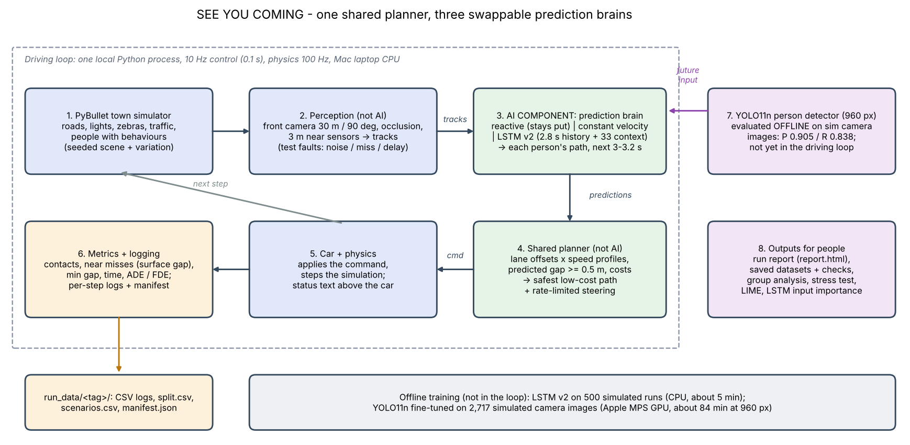
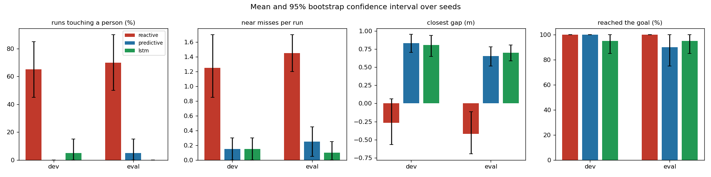
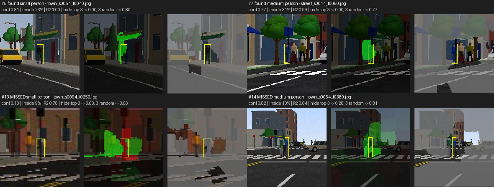
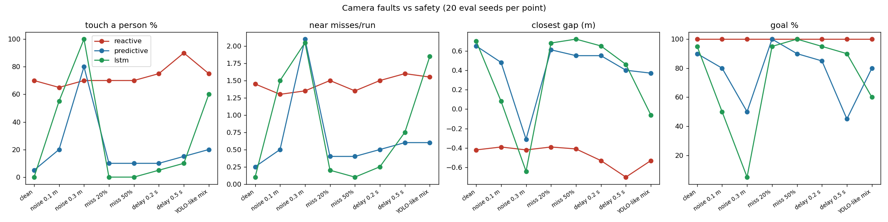

# SEE YOU COMING: predictive pedestrian avoidance for an autonomous car

A simulated self-driving car that **predicts where people are going** instead of only reacting to where they are now.
I built the whole stack: a PyBullet town simulator, perception, three swappable prediction "brains", one shared
motion planner, a trained LSTM trajectory predictor and a fine-tuned YOLO11 person detector. The evaluation is
reproducible and includes trustworthiness checks (LIME, input importance, stress tests).

University of Florida, M.S. AI Systems, course project (Fall 2026), by Pisipati Kartikeya Anirudh.



## Results at a glance

Held-out evaluation seeds (2000-2019, reserved before any tuning). Each brain drives the **same 20 scenes**. In
these runs the brains get people's positions from the simulator (perfect sensing); the stress test below adds sensor faults.

| Brain | Runs touching a person | Reached the goal | Success (goal, no contact) |
|---|---|---|---|
| Reactive (sees people where they are now) | 70% | 100% | 30% |
| Predictive, constant velocity | 5% | 90% | 85% |
| Predictive, LSTM v2 | 0% | 95% | 95% |

- **Prediction is what makes the car safe.** Both predictive brains cut contacts from 70% of runs to 0-5%.
- **LSTM vs. constant velocity:** the per-seed paired comparison finds **no significant difference** on clean
  data, so constant velocity is the selected brain for now and the LSTM stays optional.
- **LSTM v2 accuracy** (500 simulated runs, 56,021 validation examples): ADE **0.45 m** vs. 0.58 m for constant
  velocity (22% lower), FDE 0.96 m vs. 1.24 m, about 3 ms for 30 people on a laptop CPU.
- **YOLO11n at 960 px** (2,717 auto-labeled sim images): precision 0.90, recall 0.84, mAP50 0.91
  (up from 0.87 at 640 px). Most of the remaining misses are people under 3% of the image height (recall 0.44).



## How it works

Every 0.1 s:

1. **Perception** (`perception.py`): the car sees people only through a front camera (30 m, 90°, with occlusion)
   plus 3 m close-range sensors, and other cars all around.
2. **Brain** (`brains.py`): predicts where each visible person will be over the next 3 s.
   - **Reactive:** where they are now.
   - **Constant velocity:** where they will be at their current speed.
   - **LSTM v2:** 2.8 s of history plus 33 context features (curb, nearest crossing and its light, nearby cars and
     people), predicted as a correction to constant velocity.
3. **Planner** (`planner.py`, the same for all brains): scores candidate lane offsets and speed profiles 4 s ahead
   against the predicted people and other cars. It keeps a 0.5 m surface gap and rate-limits steering, then drives
   the cheapest safe path.
4. **Metrics** (`metrics.py`): contacts and near misses use one definition everywhere: the surface gap between
   the car's footprint and the person (contact below 0 m, near miss below 0.5 m).

The town has 4-lane roads, junctions, traffic lights, zebra crossings, traffic cars and pedestrians with varied
behavior (groups, waiting at the curb, jaywalkers, people who turn back). It also has five scripted crossers who
test swerving left, swerving right and stopping.

## Reproducible evaluation

- **Saved run datasets** (`run_data/v3/`): per-step logs for 120 runs (3 brains × 40 seeds) and a `split.csv`
  written *before* any run. A `manifest.json` records the exact command, a code version (hash of all source
  files), the config snapshot, library versions and a SHA-256 for every file.
- **Scenario variation** per seed: crossing timing, walking speed, crowd size, traffic and behavior mix.
- **19 automated checks** (`check_run_dataset.py`) and a replay script (`reproduce_run.py`) that re-runs one
  saved scene and recomputes its near-miss count from the logs.
- **Statistics** (`analyze_runs.py`): bootstrap 95% CIs, paired per-seed comparisons and group results (by
  scripted person, crowd size, traffic and timing).

## Trustworthiness

| Check | What it showed |
|---|---|
| **LIME on YOLO** (`explain_yolo_lime.py`) | Hiding the 3 most important image regions drops confidence 0.70 → 0.14, versus 0.68 for 3 random regions, so the detector relies on the person, not the background. It also flagged 36 confident detections with no matching label, which point to gaps in the auto-labels. |
| **LSTM input importance** (`explain_lstm.py`) | Movement history matters most (0.83 m error increase when shuffled), then road context (0.48 m) and crossings (0.34 m). Nearby cars barely matter (0.02 m) because cars are rare in the training data. The last 0.4-0.8 s of history dominate. |
| **Perception stress test** (`stress_test.py`) | The LSTM is the most sensitive brain to position noise: at 0.1 m noise, 55% of its runs touch a person, against 20% for constant velocity. Missed detections barely matter. |




## Run it

```bash
conda env create -f environment.yml      # or: pip install -r requirements.txt
conda activate aml

python run_sim.py                        # watch the car drive the town (default brain: predictive)
python run_sim.py --brain lstm           # or: reactive, none
python run_sim.py --headless             # no window
# after each run, a report (report.html / .txt / .png) is saved in run_reports/
```

The [full guide](HOW_TO_RUN.md) covers the dataset, training and analysis commands. Large data (`trajectories/`,
`dataset/`, `*.csv.gz`) is not in the repository. It can be regenerated with `make_data.py`, `make_yolo_data.py`
and `make_run_dataset.py`, and the manifests' SHA-256 values verify the result.

## What's next

1. **Make the LSTM robust:** smooth tracked positions with a Kalman filter, retrain on noisy positions, add more
   training data with cars, and output an uncertainty estimate.
2. **Make YOLO stronger in the dark:** fine-tune on night, dark-clothing and shadow images. Add SAHI (sliced
   inference) as a switch that stays off by default.
3. **Deploy:** ONNX export, a FastAPI service (`/predict`, `/detect`), a Docker image and a public Hugging Face
   Spaces demo.
4. **Re-test on fresh seeds** (3000+) that none of these changes have seen.

## Tech

Python · PyTorch · Ultralytics YOLO11 · PyBullet · NumPy · pandas · scikit-learn · scikit-image (LIME superpixels) ·
Matplotlib · Blender (Python-scripted 3D models)
